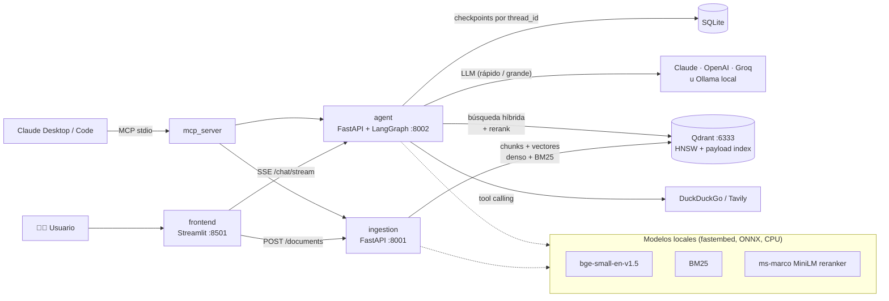
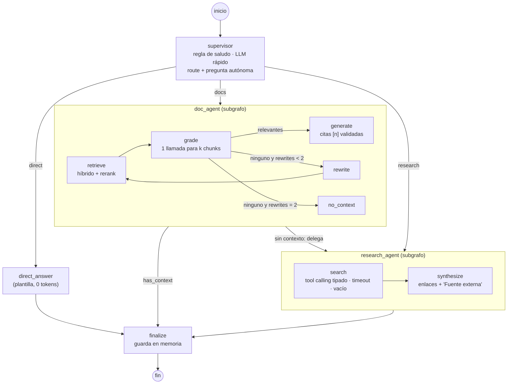

# DevDocs Agent · Asistente agéntico de documentación técnica

Sistema RAG orquestado como **grafo de agentes** (LangGraph): un **supervisor** decide si responder con la
documentación indexada, investigar en fuentes externas o contestar directamente; el **subagente de
documentación** califica lo que recupera, reescribe la consulta cuando no sirve y responde **con citas**;
el **subagente de investigación** usa una herramienta tipada de búsqueda web con manejo de errores.
API FastAPI, chat Streamlit, Qdrant, embeddings locales, todo en Docker, y un modo **100 % local** sin API keys.

> **Diseño orientado a costo**: embeddings, BM25 y reranker corren en CPU local (costo cero); el modelo barato
> toma las decisiones (router, grader en lote, rewriter) y el modelo grande solo redacta; los saludos se resuelven
> sin LLM; el juez de evaluación hace una sola llamada por respuesta. Con `LLM_PROVIDER=ollama` el costo de API es cero.

---

## Contenido
1. [Arquitectura](#1-arquitectura) · 2. [Inicio rápido](#2-inicio-rápido) · 3. [Implementación paso a paso](#3-implementación-paso-a-paso)
· 4. [API](#4-api) · 5. [Decisiones de arquitectura](#5-decisiones-de-arquitectura-y-stack) · 6. [RAG: chunking, índice y citas](#6-rag-chunking-índice-y-citas)
· 7. [¿Por qué agéntico?](#7-por-qué-agéntico) · 8. [Evaluación](#8-evaluación) · 9. [Casos de falla](#9-casos-de-falla)
· 10. [Costos](#10-costos) · 11. [Patrones de diseño](#11-patrones-de-diseño-aplicados) · 12. [Retos opcionales](#12-retos-opcionales)
· 13. [Seguridad](#13-seguridad-y-secretos) · 14. [Estructura](#14-estructura-del-repositorio)

---

## 1. Arquitectura



### Grafo de agentes


El diagrama exportado por el framework se obtiene con `make graph` (`GET /graph` → `get_graph(xray=True).draw_mermaid()`).

---

## 2. Inicio rápido

Requisitos: Docker con Compose v2 (y Python 3.11+ solo para los scripts de dataset).

### Opción A · Docker con Claude (recomendada para la demo)
```bash
git clone <repo> && cd devdocs-agent
cp .env.example .env          # pega tu ANTHROPIC_API_KEY (o configura OpenAI/Groq)
docker compose up -d --build  # qdrant, ingestion, agent, frontend
python scripts/fetch_dataset.py          # ~55 docs: FastAPI, Pydantic y el cheat sheet PDF de Docker
pip install httpx && python scripts/ingest_dataset.py
open http://localhost:8501               # chat · Swagger: :8001/docs y :8002/docs
```

### Opción B · 100 % local con Ollama (sin API keys, costo cero)
```bash
cp .env.example .env
# en .env:  LLM_PROVIDER=ollama  LLM_MODEL_FAST=qwen2.5:7b  LLM_MODEL_SMART=qwen2.5:7b
make up-local                 # levanta también Ollama y descarga qwen2.5:7b (~4,7 GB)
make dataset && make ingest
```
Con GPU NVIDIA añade `deploy.resources.reservations.devices` al servicio `ollama`. En CPU las respuestas tardan más
(decenas de segundos por consulta en equipos modestos); el resto del sistema es idéntico.

### Opción C · Local sin Docker (desarrollo)
```bash
docker run -d -p 6333:6333 qdrant/qdrant:v1.17.0      # o un Qdrant ya instalado
make dev-install
make dev-ingestion   # terminal 1
make dev-agent       # terminal 2  (Ollama local en :11434 o API key en .env)
make dev-frontend    # terminal 3
```

### Comandos útiles
| Comando | Qué hace |
|---|---|
| `make test` | Tests unitarios (no requieren servicios) |
| `make eval` | Evaluación completa lineal vs agéntico (+ ablación de recuperación) |
| `make eval-quick` | Evaluación sin juez LLM: enrutamiento, latencia, costo, recuperación |
| `make graph` | Exporta el diagrama Mermaid del grafo a `docs/graph.mmd` |
| `make logs` | Logs de agente e ingesta |

---

## 3. Implementación paso a paso

Matriz de trazabilidad: cada requerimiento del enunciado y dónde está implementado.

| # | Requerimiento | Implementación |
|---|---|---|
| 1 | Ingesta PDF/TXT/MD con chunking justificado | `POST /documents` en [`services/ingestion/app/main.py`](services/ingestion/app/main.py); loaders en [`libs/core/docs_core/loaders.py`](libs/core/docs_core/loaders.py); chunking en [`chunking.py`](libs/core/docs_core/chunking.py) ([§6](#6-rag-chunking-índice-y-citas)) |
| 1 | Metadatos por chunk (origen, página/sección, fecha) | `ChunkMetadata` en [`models.py`](libs/core/docs_core/models.py): `source`, `title`, `section`, `page`, `ingested_at`, `doc_id`, `content_hash` |
| 1 | Embeddings | `BAAI/bge-small-en-v1.5` local con fastembed ([`embeddings.py`](libs/core/docs_core/embeddings.py)) |
| 2 | Supervisor con framework de grafos y estado tipado | LangGraph `StateGraph(AgentState: TypedDict)` en [`graph/builder.py`](services/agent/app/graph/builder.py) |
| 2 | Clasifica: documentación / investigación / directa | [`graph/supervisor.py`](services/agent/app/graph/supervisor.py) (`RouteDecision` estructurado + regla de saludos) |
| 2 | Delegar a investigación si documentación no tiene contexto | Arista condicional `after_docs` |
| 3 | Subgrafo retriever, grader, rewriter, generator | [`graph/doc_agent.py`](services/agent/app/graph/doc_agent.py) + `build_doc_subgraph` |
| 3 | Arista condicional y ciclo controlado | `after_grade` → `rewrite → retrieve`, máximo `MAX_REWRITES=2` |
| 3 | Citas documento + sección | Generador con `[n]`; [`citations.py`](services/agent/app/citations.py) valida y elimina citas inventadas |
| 4 | Herramienta externa tipada (tool calling) | `WebSearchArgs` (Pydantic) + `bind_tools` en [`llm.py`](services/agent/app/llm.py); proveedores en [`tools/web_search.py`](services/agent/app/tools/web_search.py) |
| 4 | Manejo de timeout y resultado vacío | `run_search` → `SearchOutcome(error="timeout"|"empty"|"provider_error")` + reintento con consulta literal |
| 4 | Indicar fuente externa y enlaces | Prefijo `🌐 Fuente externa` + `sources[].url` |
| 5 | Endpoint de consultas | `POST /chat`, `POST /chat/stream` (SSE) en [`services/agent/app/main.py`](services/agent/app/main.py) |
| 5 | Memoria por `thread_id` | Checkpointer `SqliteSaver` + `messages` con `add_messages`; el supervisor reescribe la pregunta autónoma |
| 5 | Agente que respondió y nodos recorridos | `agent`, `steps`, `route_reason`, `rewritten_queries`, `metrics` en `ChatResponse` |
| 5 | LLM a elección | Claude por defecto; OpenAI, Groq u Ollama por `.env` (`init_chat_model`) |
| 6 | Chat con carga de documentos, fuentes, agente y pasos | [`frontend/app.py`](frontend/app.py) |
| 7 | Base vectorial, HNSW documentado, filtro por metadatos | Qdrant en [`vectorstore.py`](libs/core/docs_core/vectorstore.py) ([§6](#6-rag-chunking-índice-y-citas)); `doc_ids` en `/chat` y `/search` |
| 8 | ≥10 preguntas, métricas, precisión del supervisor, lineal vs grafo | [`eval/`](eval/) ([§8](#8-evaluación)) |
| 9 | Dockerfiles multi-stage, Compose, `.env.example` | `services/*/Dockerfile`, `frontend/Dockerfile`, [`docker-compose.yml`](docker-compose.yml), [`.env.example`](.env.example) |

---

## 4. API

Swagger/OpenAPI generado: **http://localhost:8001/docs** (ingesta) y **http://localhost:8002/docs** (agente).

| Método | Ruta | Servicio | Descripción |
|---|---|---|---|
| POST | `/documents` | ingestion | Ingesta uno o varios archivos (multipart) |
| GET | `/documents` | ingestion | Documentos indexados |
| DELETE | `/documents/{doc_id}` | ingestion | Elimina un documento del índice |
| POST | `/search` | ingestion | Búsqueda directa (`mode`, `rerank`, `doc_ids`, `k`) |
| POST | `/chat` | agent | Consulta al grafo agéntico |
| POST | `/chat/stream` | agent | Igual, con eventos SSE `start`, `step`, `token`, `final`, `error` |
| POST | `/chat/linear` | agent | Baseline RAG lineal |
| GET | `/threads/{thread_id}` | agent | Historial de la conversación |
| GET | `/graph` | agent | Diagrama Mermaid del grafo |

```bash
# Ingesta (respuesta: created | updated | duplicate | rejected)
curl -F "files=@data/raw/fastapi__tutorial__cors.md" -F "files=@data/raw/docker_cheatsheet.pdf" localhost:8001/documents

# Consulta y seguimiento en la misma conversación
curl -s localhost:8002/chat -H 'Content-Type: application/json' \
  -d '{"question": "How do I enable CORS in FastAPI?", "thread_id": "demo-1"}' | jq '{agent, steps, sources}'
curl -s localhost:8002/chat -H 'Content-Type: application/json' \
  -d '{"question": "and how do I allow credentials there?", "thread_id": "demo-1"}' | jq .answer

# Filtrar por documento
curl -s localhost:8002/chat -H 'Content-Type: application/json' \
  -d '{"question": "list running containers", "doc_ids": ["<doc_id>"]}'

# Streaming de pasos y tokens
curl -N localhost:8002/chat/stream -H 'Content-Type: application/json' -d '{"question": "What is new in Python 3.14?"}'
```
<details><summary>Ejemplo de respuesta de <code>/chat</code></summary>

```json
{
  "thread_id": "demo-1",
  "answer": "Add CORSMiddleware with app.add_middleware(...) and list the allowed origins [1]. ...",
  "agent": "documentation",
  "route": "docs",
  "route_reason": "Question about FastAPI middleware, covered by the indexed tutorial",
  "rewritten_queries": [],
  "steps": ["supervisor", "doc_agent.retrieve", "doc_agent.grade", "doc_agent.generate", "finalize"],
  "sources": [{"ref": 1, "kind": "doc", "title": "CORS (Cross-Origin Resource Sharing)",
               "section": "CORS (Cross-Origin Resource Sharing) > Use CORSMiddleware", "doc_id": "…", "snippet": "…"}],
  "metrics": {"latency_ms": 0, "tokens_in": 0, "tokens_out": 0, "cost_usd": 0, "llm_calls": 3, "nodes": ["…"]}
}
```
(valores ilustrativos de la forma de la respuesta)
</details>

---

## 5. Decisiones de arquitectura y stack

Detalle en [`docs/adr.md`](docs/adr.md).

| Decisión | Elegido | Descartado y por qué |
|---|---|---|
| Orquestación | **LangGraph** (estado tipado, subgrafos, checkpointer, streaming, `draw_mermaid`) | LlamaIndex Workflows: menos maduro en memoria/checkpoints; CrewAI/agentes prefabricados: el enunciado exige grafo propio |
| Base vectorial | **Qdrant** (HNSW, payload index, vectores dispersos con IDF y fusión RRF nativos) | pgvector: híbrido BM25 requiere armarlo aparte; Chroma: sin híbrido nativo ni filtros tan finos; Pinecone: costo y no corre local |
| Embeddings | **bge-small-en-v1.5 local (fastembed/ONNX)** | APIs (OpenAI/Voyage): costo por token y dependencia de red; modelos grandes: más RAM sin ganancia clara en un corpus pequeño |
| Búsqueda | **Híbrida denso + BM25 (RRF) + rerank cross-encoder local** | Solo denso: falla con nombres exactos de APIs (`response_model`, `BackgroundTasks`) |
| LLM | **Claude** por niveles: Haiku decide, Sonnet redacta; intercambiable por `.env` | Un solo modelo grande para todo: ~3 veces más costo en las llamadas de decisión con los precios de referencia del `.env` |
| Memoria | **Checkpointer SQLite** en volumen | Postgres/Redis: infraestructura extra innecesaria para un solo nodo (migrable sin tocar el grafo) |
| Investigación | **DuckDuckGo** gratis por defecto, **Tavily** si hay key | Solo Tavily: exige key; GitHub API: no cubre preguntas generales |
| Frontend | **Streamlit** | React/Next.js: más código sin aportar a lo evaluado |
| Evaluación | **LLM-as-judge propio** (1 llamada por respuesta) + métricas deterministas de recuperación | Ragas: varias llamadas por métrica (más costo) y más dependencias |
| Despliegue | **Compose** con 4 servicios + perfiles `local` y `eval` | Kubernetes: fuera de alcance para la prueba |

---

## 6. RAG: chunking, índice y citas

### Estrategia de chunking (estructural + tamaño)
1. **División por encabezados** en Markdown (h1 > h2 > h3) y **por página** en PDF: la documentación técnica ya está
   organizada así, y la ruta de encabezados se convierte en la **sección citable** (`Tutorial > Query Parameters > Optional`).
2. Dentro de cada sección, partición por párrafos con **máximo ~1 400 caracteres (~350 tokens)** y **solape de ~200 (~15 %)**
   solo cuando una sección se parte. bge-small trunca a 512 tokens: quedamos holgados y los chunks son específicos.
3. **Los bloques de código no se parten** si caben: un ejemplo cortado a la mitad es peor que inútil.
4. Las piezas diminutas (< 120 caracteres) se fusionan con la anterior.
5. **Contexto en el embedding**: se vectoriza `título | sección + texto` (contextual chunking a costo cero); se muestra y cita solo el texto.

Descartados: chunking semántico por embeddings (más lento y caro de ingestar, ganancia marginal en documentos ya bien
estructurados); tamaño fijo sin estructura (corta ejemplos de código y pierde la sección para citar).

### Índice Qdrant
| Parámetro | Valor | Razón |
|---|---|---|
| Vector denso | 384 dims, coseno | Dimensión de bge-small |
| `m` | 16 | Equilibrio recall/memoria para colecciones < 1 M vectores |
| `ef_construct` | 128 | Grafo de mayor calidad a cambio de indexación algo más lenta (indexamos poco, consultamos mucho) |
| `hnsw_ef` (consulta) | 96 | Recall alto con latencia de milisegundos en este tamaño |
| Vector disperso `bm25` | `modifier=IDF` | BM25 nativo: Qdrant calcula IDF sobre la colección |
| Payload index | `doc_id`, `source`, `content_hash` (keyword) | Filtro por documento sin escaneo; detección de duplicados |
| Fusión | RRF sobre prefetch denso (k·2) + BM25 (k·2) | Sin calibrar pesos entre puntuaciones incomparables |

### Citas
El generador recibe fragmentos numerados (`[n] Título — Sección`) y debe citar cada afirmación con `[n]`.
[`citations.py`](services/agent/app/citations.py) conserva solo las referencias que existen (elimina citas inventadas)
y devuelve por cada una documento, sección, página y fragmento.

---

## 7. ¿Por qué agéntico?

Cada componente agrega latencia y tokens; solo se justifica si cambia el resultado. Costos estimados por diseño
(tokens aproximados con los valores por defecto); los medidos están en `eval/results/report.md` tras correr `make eval`.

| Agente / nodo | Problema que resuelve | Ejemplo donde cambia el resultado | Costo agregado |
|---|---|---|---|
| **Supervisor** | El RAG lineal busca en la documentación aunque la pregunta no tenga nada que ver | "Recomiéndame una receta de ajiaco": el lineal recupera fragmentos al azar y puede inventar; el grafo responde que está fuera de alcance | 1 llamada al modelo rápido (~0,5–1 k tokens); **0** en saludos (regla) |
| Supervisor: pregunta autónoma | Seguimientos con pronombres ("¿y con cookies?") recuperan mal | Tras "How do I enable CORS?", "and with credentials?" se reescribe a "How to allow credentials with CORS in FastAPI" | Incluido en la llamada del router |
| **Grader** (en lote) | Fragmentos parecidos pero inútiles inducen respuestas incorrectas | "Which Docker command lists running containers?" recupera texto de Docker en general; el grader deja solo el del cheat sheet | 1 llamada rápida para los k chunks (~2–4 k tokens de entrada) |
| **Rewriter** + ciclo | Preguntas coloquiales o en español contra documentación en inglés | "¿cómo hago que mi endpoint devuelva un 404…?" → "raise HTTPException status_code 404 FastAPI" | Solo si nada es relevante: +1 llamada rápida + 1 búsqueda + 1 grading por ciclo (máx. 2) |
| **Generator** con citas validadas | Respuestas sin trazabilidad o con citas inventadas | Cualquier respuesta: cada afirmación lleva `[n]` verificable | Igual que el lineal (misma llamada) |
| **no_context → research** | El lineal contesta "no sé" o alucina cuando la documentación no cubre el tema | "Latest stable Kubernetes release?" → búsqueda web con enlaces | Ciclo de rewrites + 1 llamada de planner + búsqueda + 1 síntesis |
| **Research agent** | Información reciente o fuera del corpus | "How to configure HNSW in Qdrant?" | 1 llamada rápida (tool call) + búsqueda (gratis con DuckDuckGo) + 1 llamada grande |
| **Direct answer** | Saludos y temas fuera de alcance no deben gastar recuperación ni generación | "Hola, ¿qué puedes hacer?" | Plantilla: 0 tokens |

---

## 8. Evaluación

```bash
make eval          # o: AGENT_URL=... INGESTION_URL=... python eval/run_eval.py
```
- **Dataset** [`eval/dataset.jsonl`](eval/dataset.jsonl): 14 preguntas con respuesta esperada: 6 cubiertas, 3 coloquiales/en
  español diseñadas para activar el rewriter, 3 no cubiertas (investigación) y 2 fuera de alcance/saludo.
- **Sistemas comparados sobre las mismas preguntas**: `linear_rag` (denso, sin rerank: recuperar → generar) y `agentic_graph`.
- **Métricas por respuesta (juez LLM propio, una llamada)**: faithfulness, answer relevancy, correctness frente a la
  respuesta esperada y context precision (precisión promedio por posición, estilo Ragas).
- **Precisión del supervisor**: agente que respondió vs agente esperado.
- **Operación**: latencia p50, tokens y costo total por sistema.
- **Ablación de recuperación (reto B)**: hit@5 y MRR@5 para denso, híbrido e híbrido + rerank, usando la fuente
  esperada de cada pregunta (determinista, sin costo de LLM).

Salida: `eval/results/report.md` (tablas globales, por categoría, ablación y detalle por pregunta) y `results.json`.

### Resultados
> Ejecuta `make eval` y pega aquí las tablas de `eval/results/report.md`.
> Lectura esperada: en preguntas **cubiertas** ambos sistemas deberían rendir parecido (el grafo agrega latencia por el
> grader); la diferencia debería aparecer en **rewrite**, **not_covered** y **out_of_scope**. Si no aparece, el grafo no se
> justifica para ese tipo de consulta, y eso también es un resultado que hay que reportar.

---

## 9. Casos de falla

Hipótesis de diseño que la evaluación debe confirmar o descartar (actualízalas con los casos reales de `report.md`):

1. **Preguntas de versión sobre temas indexados** ("¿qué cambió en Pydantic 2.11?"): el supervisor puede enviarlas a
   documentación porque el tema está indexado; el grader acepta fragmentos de Pydantic genéricos y el generador responde
   con información desactualizada sin pasar a investigación. Mitigación: regla en el prompt del supervisor para
   versiones/fechas y un campo de vigencia en los metadatos.
2. **Grader demasiado estricto con preguntas en español**: fragmentos en inglés correctos marcados como irrelevantes →
   rewrites innecesarios y, en el peor caso, delegación a la web con información menos precisa. Mitigación: el rewriter
   ya traduce a terminología en inglés; evaluar un umbral de "al menos un fragmento relevante" con el reranker.
3. **Bloqueos de DuckDuckGo por volumen**: devuelve error o vacío y el agente responde que no pudo investigar. El manejo
   es correcto pero la respuesta no ayuda. Mitigación: `SEARCH_PROVIDER=tavily` en producción.
4. **PDF con tablas** (cheat sheet): `pypdf` aplana columnas y mezcla comandos de filas vecinas; la cita de página es
   correcta pero el fragmento puede ser confuso. Mitigación: parser con layout (Docling, Unstructured) para PDFs.

---

## 10. Costos

| Palanca | Efecto |
|---|---|
| Embeddings, BM25 y reranker locales (CPU) | 0 USD por ingesta y por búsqueda |
| Niveles de modelo | Router, grader, rewriter y planner en el modelo rápido; solo generator y síntesis en el grande |
| Grader en lote | 1 llamada para todos los fragmentos en lugar de k llamadas |
| Regla de saludos y plantillas | 0 tokens en saludos y fuera de alcance |
| Ciclo acotado | `MAX_REWRITES=2`: tope de costo por consulta |
| Recorte de fragmentos para el grader | 900 caracteres por fragmento al calificar |
| Ingesta incremental | No se recalculan embeddings de documentos sin cambios |
| DuckDuckGo por defecto | Investigación sin costo de API |
| Juez de evaluación en una llamada | Evaluación más barata que Ragas |
| `LLM_PROVIDER=ollama` | Costo de API cero (paga hardware) |

Cada respuesta incluye `metrics.cost_usd` (precios configurables en `.env`) y el desglose por nodo.

---

## 11. Patrones de diseño aplicados

| Patrón | Dónde |
|---|---|
| Supervisor / Router (workflow agéntico) | `graph/supervisor.py` |
| RAG correctivo: evaluator-optimizer (grader + rewriter con ciclo acotado) | `graph/doc_agent.py` |
| Subgrafos por agente (orquestación jerárquica) | `graph/builder.py` |
| Ports & Adapters (`AgentLLM`, `RetrieverPort`) | `app/ports.py`, `docs_core/ports.py` |
| Strategy (proveedor de LLM, de búsqueda, modo de recuperación) | `llm.py`, `tools/web_search.py`, `retrieval.py` |
| Adapter (PDF/MD/TXT; DuckDuckGo/Tavily a un formato común) | `loaders.py`, `web_search.py` |
| Repository (Qdrant) | `vectorstore.py` |
| Composition Root / Factory | `container.py`, `build_graph` |
| Decorator (telemetría por nodo) | `telemetry.timed` |
| Timeout + Fallback (búsqueda, router) | `run_search`, `Supervisor.route` |
| Idempotent Receiver (ingesta por hash, IDs deterministas) | `ids.py`, `ingestion/service.py` |
| Model cascading / tiering | `LLM_MODEL_FAST` / `LLM_MODEL_SMART` |
| Checkpointing (memoria durable por thread) | `SqliteSaver` |

---

## 12. Retos opcionales

| Reto | Estado | Cómo verlo |
|---|---|---|
| **A. MCP** | ✅ `search_docs`, `ingest_document`, `ask` | [`docs/mcp.md`](docs/mcp.md) |
| **B. Híbrida + reranking** | ✅ Denso + BM25 con RRF + cross-encoder local; ablación en la evaluación | `RETRIEVAL_MODE`, `RERANK_ENABLED`, tabla de ablación |
| **C. Streaming** | ✅ SSE con pasos y tokens; el chat los muestra en vivo | `POST /chat/stream` |
| **D. Human-in-the-loop** | ⏭️ No implementado | Se priorizó calidad en los demás; se haría con `interrupt()` antes de `research_agent` |
| **E. Observabilidad** | ✅ Latencia por nodo, tokens y costo en cada respuesta; Langfuse opcional por `.env` | `metrics` en la respuesta |
| **F. Ingesta incremental** | ✅ Duplicados por hash, versiones modificadas por `source`, IDs deterministas | Re-ejecuta `make ingest` |

---

## 13. Seguridad y secretos
- Ninguna clave en el código ni en Git: `.env` está en `.gitignore`; `.env.example` documenta cada variable.
- Contenedores sin root (`uid 10001`) y sin herramientas de compilación en la imagen final (multi-stage).
- Validación de entrada con Pydantic (longitud de preguntas, tipos de archivo, tamaño máximo de carga).
- Los fragmentos recuperados y resultados web se tratan como datos en los prompts; el agente no tiene herramientas con efectos destructivos.
- Antes de publicar el repositorio: `git log -p | grep -i "api_key"` no debe mostrar nada.

---

## 14. Estructura del repositorio
```text
.
├── libs/core/docs_core/        # compartido: config, modelos, chunking, loaders, ids, embeddings, Qdrant, retriever
├── services/
│   ├── ingestion/              # FastAPI de ingesta (Dockerfile multi-stage)
│   └── agent/app/
│       ├── graph/              # supervisor, doc_agent, research_agent, builder
│       ├── tools/web_search.py # herramienta tipada con timeout
│       ├── llm.py · ports.py   # adaptador LangChain y puerto del LLM
│       ├── citations.py · telemetry.py · linear_rag.py
│       ├── main.py             # API: /chat, /chat/stream, /chat/linear, /threads, /graph
│       └── mcp_server.py       # reto A
├── frontend/app.py             # chat Streamlit
├── eval/                       # dataset, juez, métricas, run_eval, results/
├── scripts/                    # descarga e ingesta del dataset
├── tests/                      # unitarios (sin servicios) + integración del grafo (CI)
├── docs/                       # ADRs, MCP, guion del video
├── docker-compose.yml · Makefile · .env.example
└── .github/workflows/ci.yml
```
